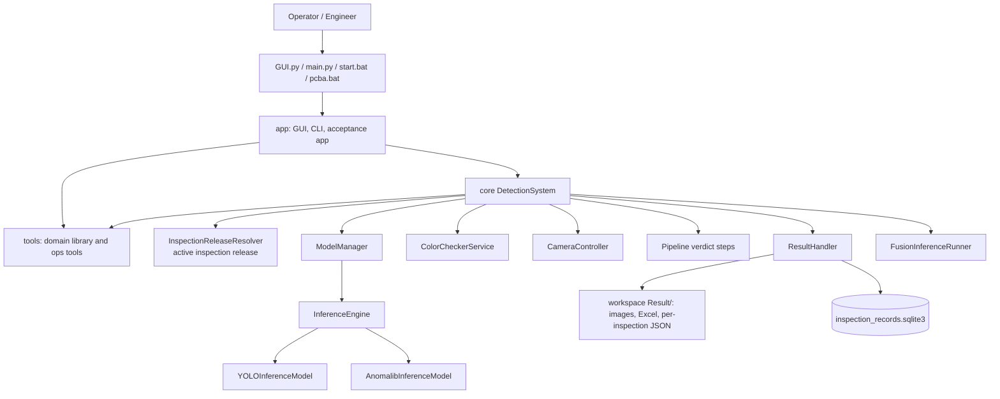
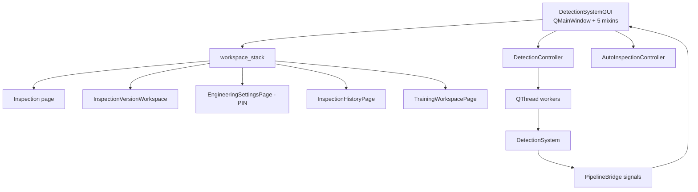

# Module Architecture

Traditional Chinese version: [MODULE_ARCHITECTURE_ZH_TW.md](MODULE_ARCHITECTURE_ZH_TW.md)

This document describes the current `yolo11_inference` runtime architecture. It
is meant to help engineers find the right module before changing behavior.
Checked against commit `f5357b3` on 2026-10-06, excluding uncommitted work in the
working tree. Classes and methods are named; line numbers are not given.

Training-side counterpart:
[`Yolo11_auto_train/docs/ARCHITECTURE.md`](../../../Yolo11_auto_train/docs/ARCHITECTURE.md).
Its §1 lists every file contract between the two repositories.

## Classification

Class B: business/internal production tooling with CV inference. The code needs
clear module ownership, testable boundaries and safe resource handling, but it
should not be forced into enterprise-style layers where simple functions are
enough.

## High-Level Layers

`tools/` is **not just ops scripts**. Eight `core/services` modules and nineteen
`app/` modules import it, and the production color path depends on it
(`ColorOverrideLoader` → `tools.color_configuration_resolver`). Treat a change to
a `tools/` module that `core` imports with the same care as a change to `core`.

## Subsystem Map

| Subsystem | Main modules | Responsibility | Detailed docs |
|---|---|---|---|
| **Inspection core** | `core/detection_system.py`, `core/services/model_manager.py`, `core/inference_engine.py`, `core/fusion_inference.py` | Load config and models, capture, infer, decide, persist | The sections below |
| **Workspace and station data** | `core/workspace.py`, `core/station_data.py`, `tools/migrate_station_data.py`, `tools/relocate_result_data.py` | Resolve every mutable path from `workspace.yaml` | "Workspace And Station-Data Paths" below |
| **Inspection releases and model versions** | `inspection_release_models/_store/_builder`, `inspection_component_catalog`, `model_version_registry`, `color_profile_store`; GUI `inspection_version_workspace`, `inspection_release*_dialog`, `model_versions_dialog` | Immutable, checksummed bundles of model config, color revisions and color model per scope; atomic activation and rollback (FULL / LIMITED_TRIAL / RISK_ACCEPTED) | [Model Version Guide](../model_lifecycle/MODEL_VERSION_GUIDE.md), [Release and Rollback SOP](../operations/RELEASE_ROLLBACK_SOP.md) |
| **Stats color check** | `core/stats_color_checker.py`, `color_sampling.py`, `color_baseline_contract.py` (`stats-robust-v6`), `services/color_checker.py`, `slot_roi.py`, `station_color_settings.py`, `color_override_loader.py`, `color_revision_contract.py`; baseline rebuild in `color_baseline_recalibration/_evidence` | Per-item color verdict against versioned baselines. One baseline-compatibility rule shared by runtime, acceptance picker and publication gate | [Color Review and Calibration](../model_lifecycle/COLOR_REVIEW_CALIBRATION.md) |
| **Pre-shift color check / golden board** | `color_preflight*`, `golden_sample`, `golden_sample_preview`; GUI `color_preflight_*`, `golden_sample_*`, `color_gamut_view` | Start-of-shift Lab-grid comparison against a physical reference board (`golden-lab-registered-v5`, frames registered to the baseline first). Read-only; never adjusts baselines | [Golden Sample Preflight](../operations/GOLDEN_SAMPLE_PREFLIGHT.md) |
| **Illumination and exposure calibration** | `auto_calibrator`, `calibration_session`, `light_controller` (serial LED); GUI `calibration_*`, `auto_calibration_handler`, `light_handler` | Drive luma to the recorded target (LED coarse, exposure fine). The exposure override is session-only and never written to config | [Camera Diagnostics](../operations/CAMERA_RUNTIME_DIAGNOSTICS.md) |
| **Auto-trigger inspection** | `core/auto_trigger.py`, `app/gui/auto_inspection_controller.py`, `models/
/<a>/auto_trigger.yaml` | A presence/stability state machine picks the best frame, then calls `detect()` | – |
| **Verdict layer** | `pipeline/finalize.py`, `decision_engine`, `cross_class_duplicate_filter`, `detection_sequence`, `missing_slot_checker`, `alignment`, `position_validator` | Recompute the final PASS/FAIL from color-corrected signals; cross-class duplicate filtering (`report_only` / `suppress`); slot and sequence checks | [Cross-Class Duplicate Pilot](../pilot/CROSS_CLASS_DUPLICATE_DETECTION_PROPOSAL.md) |
| **Inspection history DB and company sync** | `inspection_database`, `inspection_repository`, `inspection_history`, `inspection_excel_report`, `inspection_maintenance`, `inspection_sync`; GUI `inspection_history_page` | Index every result JSON into SQLite; backups and retention; offline-first outbox to the company API | [Inspection Database](../data/INSPECTION_DATABASE.md), [Company Sync](../data/COMPANY_SERVER_SYNC.md) |
| **Review and batch processing** | tools `review_workflow/_routing/_classification/_action_planner`, `review_repair*`, `historical_cleanup`, `processing_*`, `dataset_preparation*`, `annotation_*`, `color_calibration_*`, `color_feedback`; GUI `review_cases_dialog`, `review_workspace`, `processing_batch_dialog` and view models | Operator review of failed cases → routing (retrain / annotate / color) → auditable, reversible batch processing | [Misjudge Triage SOP](../operations/MISJUDGE_TRIAGE_SOP.md) |
| **Retraining workspaces and handoff** | tools `retraining_workspaces`, `export_review_dataset`, `submission_history`, `operator_job_control`, `retraining_readiness`, `portable_training_package`; core `retraining_options`, `training_batch_version`; GUI `training_workspace_page`, `retraining_*`, `training_batch_dialog`, `model_update_status_dialog`, `training_launcher` | Versioned retraining batches, the handoff JSON to Yolo11_auto_train, launching and monitoring the training worker | [Training Loop](../../../Yolo11_auto_train/docs/SEAMLESS_WORKFLOW.md) |
| **Acceptance app** | `app/acceptance/{main,window,matrix_dialog,headless,color_revision_contract}.py`, `core/services/acceptance_*`, `model_acceptance.py` | Production-equivalent standalone acceptance; YOLO × color-revision matrix; headless deploy gate (called by Yolo11_auto_train's deploy) | [Model Combination Acceptance and Release](../model_lifecycle/MODEL_COMBINATION_ACCEPTANCE.md) and "Acceptance Evidence Layer" below |
| **Engineering access** | `engineering_settings_page`, the PIN guard in `panels/control_panel.py`, `model_config_dialog` + `model_config_editor` | PIN-gated engineering, retraining and version controls | [Engineering Manual](../manuals/ENGINEERING_MANUAL.md) |
| **Deployment preflight** | `tools/system_check/` (standalone exe), `check_runtime_environment`, `production_readiness_check`, `production_preflight`, `core/runtime_preflight.py` | Can this machine and this config run production? | [System Check](../../tools/system_check/README.md), [Go-Live Checklist](../operations/PRODUCTION_GO_LIVE_CHECKLIST.md) |

## Entrypoints

| Entrypoint | Purpose | Notes |
| --- | --- | --- |
| `start.bat` | Main station launcher | Runs `tools/check_runtime_environment.py` → `GUI.py --check-onnxruntime` → `GUI.py` |
| `GUI.py` | PyQt GUI and packaged executable entrypoint | Diagnostic flags: `--check-onnxruntime`, `--check-hikrobot-runtime`, `--check-camera-grab` |
| `main.py` | CLI interactive or one-shot inference | `--type` accepts only `yolo` and `anomalib`; there is no `fusion` |
| `start_model_acceptance.bat` | Acceptance app | `python -m app.acceptance.main` |
| `python -m app.acceptance.headless` | Headless model acceptance gate | Run as a subprocess by Yolo11_auto_train's deploy |
| `collect_training_data.bat` / `一鍵蒐集訓練資料.bat` | Fallback entry for collecting retraining data | Calls `tools/review_training_data.py` |
| `pcba.bat` | Operator wrapper for PCBA pilot commands | Calls `tools/pcba_pilot.py` |
| `tools/system_check/system_check.exe` | Preflight for a new machine | Packaged separately |
| `tools/*.py` | Other ops tools | Readiness, database maintenance, sync admin, benchmark and more |

The PyInstaller spec builds `yolo11_inference.exe` from `GUI.py`. A flag the
packaged executable accepts is not necessarily accepted by `python main.py`.

## Workspace And Station-Data Paths

Every mutable path is resolved from `workspace.yaml` at the workspace root
(`core/workspace.py`), no longer from the project root.

1. **Discovery order:** the `YOLO11_WORKSPACE_ROOT` environment variable → the
   nearest ancestor containing `workspace.yaml` → the legacy sibling layout.
2. **Validation:** an invalid `workspace.yaml` raises; it is **never** silently
   ignored. Every path must be relative and stay inside the workspace.
3. **Station paths:** `core/station_data.py::station_data_paths_from_workspace`
   expands `station_data` into the station-owned directories:
   - `logs/`, `acceptance/`, `acceptance_reports/`
   - `.color_baselines/`, `.color_preflight/`, `.color_profiles/`, `.color_revisions/`
   - `.inspection_releases/` (pointers to the active release)
   - `.processing_runs/`, `.review_repairs/`

In the current checkout:

| Path | Location |
| --- | --- |
| Models | `yolo11_inference/models` |
| Inspection results and SQLite | `Result/` at the workspace root (**outside the project directory**) |
| Station data | `station_data/yolo11_inference` |

## Core Runtime

### `core/detection_system.py`

`DetectionSystem` is the runtime coordinator. It is intentionally a facade,
because the GUI, CLI and acceptance app all need one stable entry point. It owns:

- loading global config and resolving workspace and station-data paths;
- **resolving the active inspection release** (`InspectionReleaseResolver`), so
  the release-pinned model config, color revisions and color model take
  precedence over the live config;
- obtaining product/area/type config and engines through `ModelManager`;
- loading the color checker service with per-model overrides and the active color
  revisions, failing closed when it cannot load safely;
- the camera lifecycle, including the session-only exposure override and waiting
  for exposure to settle before capture;
- synchronous `detect(...)`, asynchronous `start_pipeline(...)` /
  `stop_pipeline()`, and auto-trigger preparation (`prepare_auto_inspection`);
- serialising inference through the single-flight `_inference_lock`;
- refreshing and closing result sinks, and optional runtime preflight.

The acceptance-only constructor arguments (`models_root`,
`color_revision_overrides`, `model_config_overrides`, `inspection_releases_root`)
let the acceptance app inject a combination under test without touching
production state. Domain decisions that can be isolated belong in services or
pipeline steps.

### `core/services/model_manager.py`

`ModelManager` loads `<models_root>/<product>/<area>/<type>/config.yaml`, where
`models_root` comes from `paths.inference_models` in `workspace.yaml`. It applies
model-level overrides to a copy of the base config.

- **When a release pins the config:** it uses the release's config snapshot and
  then restores the **station-local fields** (exposure, gain, calibration, ROI and
  so on, listed in `model_version_registry.STATION_LOCAL_FIELDS`) from the live
  config. Yolo11_auto_train's deploy keeps its own copy of that list, so change
  both together.
- **Cache:** an LRU keyed by (product, area), with one engine per type. A cached
  engine is reused only when the config signature matches; an activation lock
  covers safe engine replacement.

State safety: overrides are applied to deep copies; cached engines are protected
by a lock; config snapshots are copied before return.

### `core/inference_engine.py`

`InferenceEngine` dispatches to lazily loaded backends: YOLO artifacts use
`YOLOInferenceModel` (ONNX or PT chosen by `core/yolo_runtime.py`); Anomalib
configs use `AnomalibInferenceModel`; optional custom backends live under the
`core.backends.` prefix. Lazy loading keeps YOLO-only startup fast and avoids
importing the full Anomalib/Lightning stack until it is needed.

### `core/fusion_inference.py`

When a product/area has both YOLO and Anomalib backends, fusion loads both
components (on a two-thread executor with a timeout) and combines their results;
`DetectionSystem` then does not use a single `inference_engine`. Fusion is
available to GUI/API paths; `main.py --type` has no `fusion` choice.

### `core/pipeline/*`

The pipeline registry builds verdict steps from config: `color_check`,
`position_check`, `cross_class_duplicate_filter`, `count_check`,
`sequence_check`, `save_results`.

- **Default pipeline:** `color_check` + `save_results` when color checking is
  enabled; `save_results` is appended when missing.
- **Enforced order:** `cross_class_duplicate_filter` must run after
  `color_check` and before `count_check` / `sequence_check` / `save_results`;
  critical steps must not repeat.
- **Final verdict:** `finalize_status` in `pipeline/finalize.py` runs after the
  verdict steps and before `SaveResultsStep`.

Implement optional product-specific behavior as a pipeline step instead of
adding product conditionals to `DetectionSystem`.

### `core/services/results/*`

`ResultHandler` owns:

- output path management, constrained under the workspace result root;
- annotated images and failure crops;
- buffered Excel output (a background thread; the blocking flush happens in
  `shutdown()`);
- a per-inspection `*_config_snapshot.json`, upserted into the SQLite database
  `inspection_records.sqlite3`;
- optional notification of the company-API sync outbox, and scheduling of backup
  and retention;
- operator/customer messages (`customer_message`).

`results/` writes no CSV. The CSV review manifest comes from
`tools/collect_review_cases.py`. Result writing is kept separate from inference
so tests can validate decisions without a camera or GPU.

## Camera Layer

| Module | Responsibility |
| --- | --- |
| `camera/camera_controller.py` | High-level camera lifecycle used by core |
| `camera/MVS_camera_control.py` | Hikrobot MVS SDK integration |
| `camera/preview/*` | Preview application and metrics; `camera/camera_preview.py` is the compatibility entrypoint |

Packaged camera diagnostics are implemented in `GUI.py`, so they are available
inside `yolo11_inference.exe`. Exposure is re-derived at startup and on station
switch, for the session only; for illumination calibration see the subsystem map.

## GUI Layer

### `app/gui/main_window.py`

`DetectionSystemGUI` is a `QMainWindow` plus five mixins: Camera, Light,
Calibration, AutoCalibration and ColorPreflight. It switches pages through
`workspace_stack` and wires panels, controller actions and view updates. It
coordinates UI state and must not implement inspection logic. Retraining,
engineering settings and version controls sit behind the PIN-gated engineering
page.

### `app/gui/controller.py`

`DetectionController` is the application coordinator. It lazily creates
`DetectionSystem`, creates workers and reloads model configs. It should not own
domain decisions.

### `app/gui/workers.py`

Workers move blocking operations off the UI thread: loading the model catalog,
initializing the camera, running the detection pipeline and shutting down. Use
worker signals to update the UI; do not mutate widgets from background threads.

## Synchronous Detection Flow

The full signature is
`detect(product, area, inference_type, frame=None, cancel_cb=None, *, persist=True)`.

1. The CLI, GUI or acceptance app calls `detect(...)`. If another inference or
   the pipeline is running, the single-flight lock makes this call return ERROR
   instead of queueing.
2. The active inspection release for the scope is resolved. Its pinned model
   config (`config_path_override`), color revisions and color model take
   precedence; station-local fields are restored from the live config.
3. `ModelManager` returns the engine and config pair (fusion loads both
   components).
4. The color checker service is loaded; camera exposure and gain are applied and
   allowed to settle before capture (when no `frame` is passed).
5. `InferenceEngine` lazily loads the backend and infers.
6. `result_adapter.normalize_result` normalizes the output into a **dict** (not
   a `DetectionResult`); FAIL is remapped to `DETECTION_FAIL` here.
7. The verdict steps run, then `finalize_status` computes the final status and
   reason codes; only then is a `DetectionResult` built.
8. With `persist=True`, `SaveResultsStep` writes images, Excel, the
   per-inspection JSON and the SQLite row. The acceptance app re-runs with
   `persist=False` and writes no production results.

## Single-Shot And Continuous Inspection

| Situation | Actual path |
| --- | --- |
| Camera single shot | The GUI creates a `DetectionWorker` → `start_pipeline(mode="single")` → `AsyncPipelineManager` (acquisition, inference and storage workers decoupled by queues) |
| Image-file single shot | `detect()` on a `threading.Thread` |
| Hands-free continuous inspection | `AutoInspectionController`: a preview QThread plus `AutoTriggerStateMachine` picks the best frame, then calls `detect()` on a daemon thread |

What `stop_pipeline()` does:

- it **drops** queued inference and storage tasks; it does **not** flush them;
- it sends poison pills and joins the workers within a bounded total timeout;
- a worker still alive after the timeout keeps ownership and blocks a restart;
- `StorageWorker` only schedules an asynchronous Excel flush; the blocking flush
  happens in `shutdown()`.

## Configuration Ownership

| Config | Owner | Notes |
| --- | --- | --- |
| `workspace.yaml` (workspace root) | cross-project paths | Each repository parses it; workspace CI checks both agree |
| `config.yaml` | global runtime defaults | Not necessarily production-ready for PCBA |
| `config.example.yaml` | template | Safe starting point, not a validated product config |
| `models/<product>/<area>/<type>/config.yaml` | product model/runtime config | Published by Yolo11_auto_train's deploy, with `config.yaml` written last as the commit point; the pilot readiness gate should target this file |
| `models/<product>/<area>/<type>/versions/*.config.yaml` | per-version config snapshots | Version activation and rollback restore from these |
| `models/<product>/<area>/auto_trigger.yaml` | auto-trigger parameters | Per station |
| `station_data/.inspection_releases/` | active release pointer per scope | Release contents are immutable; only the pointer moves |
| `station_data/.color_revisions/`, `.color_profiles/`, `.color_baselines/`, `.color_preflight/` | color revisions, profiles, baselines, preflight records | Station-owned; never overwritten by a model publish |
| Station-local fields | always taken from the live config | Listed in `model_version_registry.STATION_LOCAL_FIELDS`; preserved by release pinning and version activation |
| `configs/products/*.yaml` | product examples/templates | Not a substitute for measured fixture values |

External inputs are treated as untrusted: product, area, type and paths are
validated or normalized before use.

## Acceptance Evidence Layer

The acceptance workspace is separate from the detection pipeline: it re-infers
existing photographs to produce comparable evidence, and writes neither official
detection results nor human ground truth. For operator procedure see
[Model Combination Acceptance and Release](../model_lifecycle/MODEL_COMBINATION_ACCEPTANCE.md).

### `core/services/acceptance_artifacts.py`

Owns the boundary of "which files one inference actually used".

- `AcceptanceArtifactBundle` binds the global config, model config, weight,
  optional color model and per-color revisions into one content-addressed
  combination.
- `verify_acceptance_artifact_bundle()` re-checks it before and after a run.
- Every acceptance entry point (the acceptance app's window, the matrix, the gate
  and the headless CLI) must take its paths from a bundle rather than assembling
  them; otherwise the files named by a report may not be the files that were
  loaded.
- `color_scope_model_type()` lives here too: fusion shares the YOLO scope for
  color artifacts. That rule must exist exactly once.

### `core/services/acceptance_runs.py`

`AcceptanceRunRepository` makes an interactive run atomic:

- each sample's result is staged in the run directory;
- state transitions are append-only events;
- the manifest is committed only once every sample has completed;
- a failed or cancelled run leaves the previous official results unchanged.

### `core/services/model_acceptance.py`

`AcceptanceRepository` owns the manifest (`ground_truth.csv`) and produces the
acceptance snapshots (`acceptance/P/A/snapshots/<id>/`) that Yolo11_auto_train's
deploy gate reads.

- Every mutation runs under `_exclusive_mutation()`; a batch commit uses a
  checksum compare-and-swap.
- Stale results are cleared by `artifact_bundle_sha256`, not by run: what a
  snapshot needs is that every result came from one identical artifact
  combination, not from one invocation.
- `calculate_acceptance_metrics()` is a total function. It runs on the display
  and reporting path, so a corrupt row is counted as `malformed` and excluded
  from every denominator instead of raising. Rejection belongs to the two
  decision points that can act on it: the gate and a formal snapshot.

### `core/services/acceptance_gate.py`

The decision logic of the headless deploy gate. It replays the frozen acceptance
set and compares the incumbent and candidate per sample; a sample the incumbent
got right and the candidate gets wrong counts as a regression.
Yolo11_auto_train's deploy calls it through `python -m app.acceptance.headless`
and requires the report to match the candidate weight, config and color sha256
exactly.

### `tools/cross_process_lock.py`

A file lock for short metadata mutations: `threading.RLock` within the process
and a byte-range lock across processes. Never hold it across inference or any
other long I/O.

### `app/gui/metric_presentation.py`

`format_count_with_rate()` renders each metric as `count (rate)` in a single
cell. Do not split the count and the rate into neighbouring columns: the overall
and color-only metric families share a denominator but not a numerator, so
splitting them invites readers to convert one into the other.

## State And Concurrency Safety

| Mechanism | Location | Protects |
| --- | --- | --- |
| Single-flight inference lock `_inference_lock` | `DetectionSystem` | One inference at a time; a busy call returns ERROR |
| Model cache lock and activation lock | `ModelManager` | Engine cache and safe replacement |
| `.deploy.lock/` directory lock | `models/P/A/<type>/` | Version activation and config edits; **shared with Yolo11_auto_train's deploy** |
| `deployment-publication.lock` | `.color_revisions/locks/` | Color revision publication; shared with the training deploy |
| Inspection release store locks | `inspection_release_store` | One per scope plus a cross-process lock |
| Handoff `export.lock` | `<training_data>/.operator_handoff/` | Serialises retraining handoff exports |
| Acceptance manifest locks | `model_acceptance` | In-process lock + cross-process file lock; batch commits also use a checksum compare-and-swap so one run cannot overwrite another's results |

Threads:

- QThread workers handle blocking GUI work;
- `detect()` runs on daemon `threading.Thread`s (image-file single shot and auto
  trigger);
- a `QThreadPool` decodes images (`async_image_service`);
- fusion uses a two-thread executor;
- Excel, image-queue, company-sync and maintenance threads run in the background;
- retraining runs as a windowless **subprocess** (`training_launcher`).

Image caches:

- The annotated-preview cache in the acceptance app window and the production
  GUI's `async_image_service` cache are both bounded.
- A full-resolution unbounded QPixmap cache once exhausted the graphics heap on
  batches of a few hundred images and killed the process with no Python
  traceback.
- Any new image cache must bound both entry size and entry count.

Other:

- Async queues prevent unbounded frame buildup.
- Config switching uses copied config snapshots.

Avoid adding shared mutable state directly to GUI widgets, workers or global
module variables. If state must be shared, make the owner explicit and document
the lifecycle.

## Extension Rules

Use the smallest extension point that fits the change:

- New product or area: add a model config and weights under `models/`.
  Production models should be published through Yolo11_auto_train's deploy.
- New optional post-processing behavior: add or configure a pipeline step and
  respect the registry's ordering rules.
- New inference backend: add a backend under `core.backends.` and enable custom
  backends explicitly.
- New domain logic: pure verdict logic belongs in `core`; a `tools/` module that
  `core` imports is held to the same testing and review standard as `core`.
- New operator workflow: expose it as a GUI page or dialog with its domain logic
  in a `tools/` module; pilot commands can extend `tools/pcba_pilot.py`.
- New UI behavior: keep UI state in `app/gui`, domain decisions in `core` or
  `tools`.
- New file or field that Yolo11_auto_train reads or writes: register it first in
  the contract table in §1 of the training-side `docs/ARCHITECTURE.md`.

Do not add a new interface or factory unless there is a real second
implementation or a clear variation axis.
