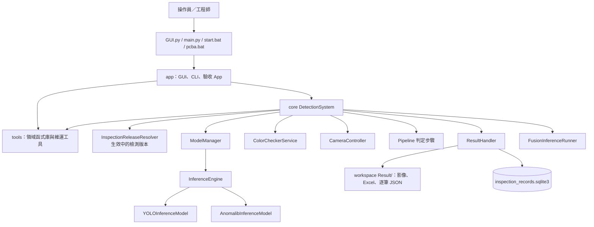
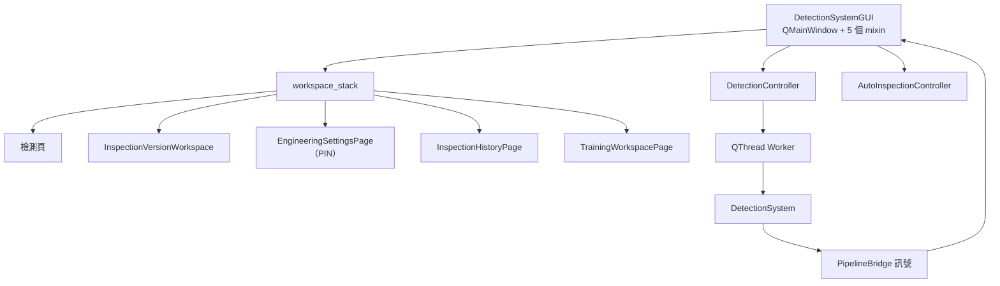

# 模組架構

英文原文：[MODULE_ARCHITECTURE.md](MODULE_ARCHITECTURE.md)

本文件說明 `yolo11_inference` 目前的執行階段架構，協助工程師在變更系統行為前找到正確的模組。
核對基準：2026-10-06，commit `f5357b3`，不含工作區中尚未提交的修改。
類別與方法以名稱標示，不標行號。

訓練端對應文件：[`Yolo11_auto_train/docs/ARCHITECTURE.md`](../../../Yolo11_auto_train/docs/ARCHITECTURE.md)。
兩個 repo 之間的完整檔案合約列在該文件的 §1。

## 系統分類

B 類：具備電腦視覺推論功能的商業／內部生產工具。程式碼必須具備清楚的模組歸屬、可測試的邊界及安全的資源管理；若簡單函式已足以解決問題，則不應強制套用企業級分層。

## 高階分層

`tools/` **不只是維運腳本**。`core/services` 有 8 個模組、`app/` 有 19 個模組 import 它，正式的顏色路徑也依賴它
（`ColorOverrideLoader` → `tools.color_configuration_resolver`）。
修改 `tools/` 底下的模組時，請比照 `core` 的標準看待。

## 子系統地圖

| 子系統 | 主要模組 | 職責 | 詳細文件 |
|---|---|---|---|
| **檢測核心** | `core/detection_system.py`、`core/services/model_manager.py`、`core/inference_engine.py`、`core/fusion_inference.py` | 載入設定與模型、取像、推論、判定、保存 | 本文以下各節 |
| **工作區與站點資料** | `core/workspace.py`、`core/station_data.py`、`tools/migrate_station_data.py`、`tools/relocate_result_data.py` | 從 `workspace.yaml` 解析所有可變路徑 | 本文「工作區與站點資料路徑」 |
| **檢測版本與模型版本** | `inspection_release_models/_store/_builder`、`inspection_component_catalog`、`model_version_registry`、`color_profile_store`；GUI 的 `inspection_version_workspace`、`inspection_release*_dialog`、`model_versions_dialog` | 把模型設定、顏色修訂、顏色模型綁成不可變、有 checksum 的組合；可原子啟用或回滾（FULL／LIMITED_TRIAL／RISK_ACCEPTED） | [模型版本指南](../model_lifecycle/MODEL_VERSION_GUIDE.md)、[發布與回滾 SOP](../operations/RELEASE_ROLLBACK_SOP.md) |
| **stats 顏色檢查** | `core/stats_color_checker.py`、`color_sampling.py`、`color_baseline_contract.py`（`stats-robust-v6`）、`services/color_checker.py`、`slot_roi.py`、`station_color_settings.py`、`color_override_loader.py`、`color_revision_contract.py`；基準重建在 `color_baseline_recalibration/_evidence` | 依版本化的顏色基準逐項判定顏色。runtime、驗收挑選、發布 Gate 共用同一條基準相容規則 | [顏色覆核與校正](../model_lifecycle/COLOR_REVIEW_CALIBRATION.md) |
| **開線前顏色檢查／Golden 板** | `color_preflight*`、`golden_sample`、`golden_sample_preview`；GUI 的 `color_preflight_*`、`golden_sample_*`、`color_gamut_view` | 用實體參考板做班前 Lab 網格比對（`golden-lab-registered-v5`，比對前先做影像對位）。只讀，不會調整基準 | [Golden Sample 開線檢查](../operations/GOLDEN_SAMPLE_PREFLIGHT.md) |
| **照明與曝光校正** | `auto_calibrator`、`calibration_session`、`light_controller`（序列埠 LED）；GUI 的 `calibration_*`、`auto_calibration_handler`、`light_handler` | 讓亮度回到記錄的目標值（LED 粗調、曝光細調）。曝光覆寫只在本次 session 有效，不寫回設定 | [相機診斷](../operations/CAMERA_RUNTIME_DIAGNOSTICS.md) |
| **自動觸發檢測** | `core/auto_trigger.py`、`app/gui/auto_inspection_controller.py`、`models/
/<a>/auto_trigger.yaml` | 依「有料、穩定」狀態機挑出最佳畫面，再呼叫 `detect()` | – |
| **判定層** | `pipeline/finalize.py`、`decision_engine`、`cross_class_duplicate_filter`、`detection_sequence`、`missing_slot_checker`、`alignment`、`position_validator` | 用顏色修正後的訊號重算最終 PASS／FAIL；跨類別重複框過濾（`report_only`／`suppress`）；槽位與順序檢查 | [跨類別重複框 Pilot](../pilot/CROSS_CLASS_DUPLICATE_DETECTION_PROPOSAL.md) |
| **檢測歷史資料庫與公司同步** | `inspection_database`、`inspection_repository`、`inspection_history`、`inspection_excel_report`、`inspection_maintenance`、`inspection_sync`；GUI 的 `inspection_history_page` | 把每筆結果 JSON 索引進 SQLite；備份與保存期限；離線優先的公司 API outbox | [資料庫](../data/INSPECTION_DATABASE.md)、[公司同步](../data/COMPANY_SERVER_SYNC.md) |
| **複核與批次處理** | tools 的 `review_workflow/_routing/_classification/_action_planner`、`review_repair*`、`historical_cleanup`、`processing_*`、`dataset_preparation*`、`annotation_*`、`color_calibration_*`、`color_feedback`；GUI 的 `review_cases_dialog`、`review_workspace`、`processing_batch_dialog` 及其 view model | 操作員複核失敗案例 → 分流（補訓、補標、顏色）→ 可稽核、可回滾的批次處理 | [誤判 SOP](../operations/MISJUDGE_TRIAGE_SOP.md) |
| **補訓工作區與交接** | tools 的 `retraining_workspaces`、`export_review_dataset`、`submission_history`、`operator_job_control`、`retraining_readiness`、`portable_training_package`；core 的 `retraining_options`、`training_batch_version`；GUI 的 `training_workspace_page`、`retraining_*`、`training_batch_dialog`、`model_update_status_dialog`、`training_launcher` | 建立版本化補訓批次、寫 handoff JSON 給 Yolo11_auto_train、啟動並監看訓練行程 | [訓練閉環](../../../Yolo11_auto_train/docs/SEAMLESS_WORKFLOW.md) |
| **驗收 App** | `app/acceptance/{main,window,matrix_dialog,headless,color_revision_contract}.py`、`core/services/acceptance_*`、`model_acceptance.py` | 與產線等效的獨立驗收；YOLO × 顏色修訂矩陣；headless 部署 Gate（Yolo11_auto_train 的 deploy 會呼叫） | [模型組合驗收與發布](../model_lifecycle/MODEL_COMBINATION_ACCEPTANCE.md)，以及本文「驗收證據層」 |
| **工程權限** | `engineering_settings_page`、`panels/control_panel.py` 的 PIN 守門、`model_config_dialog` + `model_config_editor` | PIN 保護的工程設定、補訓與版本操作 | [工程維運手冊](../manuals/ENGINEERING_MANUAL.md) |
| **部署前置檢查** | `tools/system_check/`（獨立 exe）、`check_runtime_environment`、`production_readiness_check`、`production_preflight`、`core/runtime_preflight.py` | 判斷這台機器、這份設定能不能上產線 | [部署前置檢查工具](../../tools/system_check/README.md)、[上線檢查表](../operations/PRODUCTION_GO_LIVE_CHECKLIST.md) |

## 程式進入點

| 進入點 | 用途 | 備註 |
| --- | --- | --- |
| `start.bat` | 現場主入口 | 依序執行 `tools/check_runtime_environment.py` → `GUI.py --check-onnxruntime` → `GUI.py` |
| `GUI.py` | PyQt GUI 與封裝後的執行檔進入點 | 診斷旗標：`--check-onnxruntime`、`--check-hikrobot-runtime`、`--check-camera-grab` |
| `main.py` | CLI 互動式或單次推論 | `--type` 目前只接受 `yolo` 與 `anomalib`，沒有 `fusion` |
| `start_model_acceptance.bat` | 驗收 App | `python -m app.acceptance.main` |
| `python -m app.acceptance.headless` | 無介面的模型驗收 Gate | 由 Yolo11_auto_train 的 deploy 以子行程呼叫 |
| `collect_training_data.bat`／`一鍵蒐集訓練資料.bat` | 補訓資料蒐集的備援入口 | 呼叫 `tools/review_training_data.py` |
| `pcba.bat` | PCBA 試產的操作員包裝程式 | 呼叫 `tools/pcba_pilot.py` |
| `tools/system_check/system_check.exe` | 新機器的前置檢查 | 獨立封裝 |
| `tools/*.py` | 其餘維運工具 | 就緒檢查、資料庫維護、同步管理、效能評測等 |

PyInstaller 設定檔以 `GUI.py` 建置 `yolo11_inference.exe`。封裝執行檔接受的旗標，不代表 `python main.py` 也接受。

## 工作區與站點資料路徑

所有可變路徑都從 workspace 根目錄的 `workspace.yaml` 解析（`core/workspace.py`），不再以專案根目錄為準。

1. **解析順序**：環境變數 `YOLO11_WORKSPACE_ROOT` → 往上找最近的 `workspace.yaml` → 舊版相鄰目錄布局。
2. **驗證**：`workspace.yaml` 不合法時直接報錯，**不會**靜默忽略。所有路徑都必須是相對路徑，而且不得超出 workspace。
3. **展開站點路徑**：`core/station_data.py::station_data_paths_from_workspace` 由 `station_data` 展開出各個站點專屬目錄：
   - `logs/`、`acceptance/`、`acceptance_reports/`
   - `.color_baselines/`、`.color_preflight/`、`.color_profiles/`、`.color_revisions/`
   - `.inspection_releases/`（記錄目前生效版本的指標）
   - `.processing_runs/`、`.review_repairs/`

以目前的 checkout 為例：

| 路徑 | 位置 |
| --- | --- |
| 模型 | `yolo11_inference/models` |
| 檢測結果與 SQLite | workspace 根目錄的 `Result/`（**在專案目錄之外**） |
| 站點資料 | `station_data/yolo11_inference` |

## 核心執行階段

### `core/detection_system.py`

`DetectionSystem` 是執行階段的協調器（Facade），因為 GUI、CLI、驗收 App 都需要一個穩定的進入點。它負責：

- 載入全域設定、解析 workspace 與站點資料路徑；
- **找出生效中的檢測版本**（`InspectionReleaseResolver`），讓版本鎖定的模型設定、顏色修訂與顏色模型優先於即時設定；
- 透過 `ModelManager` 取得產品／站別／類型的設定與推論引擎；
- 載入顏色檢查服務（含逐模型覆寫與生效中的顏色修訂；無法安全載入時判為失敗）；
- 相機生命週期，包括本次 session 的曝光覆寫，以及取像前等待曝光穩定；
- 同步執行 `detect(...)`、非同步執行 `start_pipeline(...)`／`stop_pipeline()`、為自動觸發做準備（`prepare_auto_inspection`）；
- 以單一飛行鎖 `_inference_lock` 序列化推論；
- 重新整理及關閉結果輸出端，並視需要執行執行階段的前置檢查。

驗收專用的建構子參數（`models_root`、`color_revision_overrides`、`model_config_overrides`、`inspection_releases_root`）讓驗收 App 能注入受測組合，而不會碰到正式狀態。
業務決策若能獨立，應放在服務或 Pipeline 步驟中。

### `core/services/model_manager.py`

`ModelManager` 載入 `<models_root>/<product>/<area>/<type>/config.yaml`，其中 `models_root` 來自 `workspace.yaml` 的 `paths.inference_models`。它把模型層級的覆寫套用到基礎設定的副本上。

- **版本鎖定時**：使用版本記錄的設定快照，再把**站點專屬欄位**（曝光、增益、校正、ROI 等，清單在 `model_version_registry.STATION_LOCAL_FIELDS`）從即時設定放回去。這份清單和 Yolo11_auto_train 的 deploy 各有一份，修改時兩邊要一起改。
- **快取**：LRU 以 (product, area) 為 key，每種類型各有一個引擎。只有設定簽章相同時才重用快取；替換引擎時有 activation lock 保護。

狀態安全措施：設定覆寫套用在深層複製的副本上；鎖保護快取中的引擎；回傳設定快照前先複製。

### `core/inference_engine.py`

`InferenceEngine` 將推論分派至延遲載入的後端：YOLO 產物使用 `YOLOInferenceModel`（ONNX 或 PT 由 `core/yolo_runtime.py` 決定）；Anomalib 設定使用 `AnomalibInferenceModel`；選用的自訂後端放在 `core.backends.` 前綴之下。
延遲載入可維持僅使用 YOLO 時的啟動速度，避免在真正需要前載入完整的 Anomalib／Lightning 技術堆疊。

### `core/fusion_inference.py`

當某個產品／區域同時具備 YOLO 與 Anomalib 後端時，融合推論會載入兩個元件（使用 2 執行緒的 executor，有逾時），合併兩者的結果；此時 `DetectionSystem` 不使用單一的 `inference_engine`。
GUI／API 路徑可以使用融合推論；`main.py --type` 沒有 `fusion` 選項。

### `core/pipeline/*`

Pipeline Registry 依設定建立判定步驟：`color_check`、`position_check`、`cross_class_duplicate_filter`、`count_check`、`sequence_check`、`save_results`。

- **預設 pipeline**：啟用顏色檢查時是 `color_check` + `save_results`；缺少 `save_results` 時會自動補上。
- **順序強制規則**：`cross_class_duplicate_filter` 必須在 `color_check` 之後、在 `count_check`／`sequence_check`／`save_results` 之前；關鍵步驟不得重複。
- **最終判定**：`pipeline/finalize.py` 的 `finalize_status` 在判定步驟之後執行，然後才執行 `SaveResultsStep`。

產品專屬的選用行為應以 Pipeline 步驟實作，不要在 `DetectionSystem` 內加入產品專屬的條件分支。

### `core/services/results/*`

`ResultHandler` 負責：

- 管理輸出路徑：輸出限制在 workspace 的結果根目錄之下；
- 產生標註影像、裁切失敗區域；
- 緩衝 Excel 輸出（背景執行緒，`shutdown()` 時做阻塞式 flush）；
- 寫出逐筆的 `*_config_snapshot.json`，並 upsert 到 SQLite `inspection_records.sqlite3`；
- 視設定通知公司 API 同步 outbox，並排程備份與保存期限清理；
- 產生面向操作員／客戶的訊息（`customer_message`）。

`results/` 不寫 CSV。複核用的 CSV manifest 由 `tools/collect_review_cases.py` 產生。
結果寫入刻意與推論分離，使測試不依賴實體相機或 GPU 也能驗證決策行為。

## 相機層

| 模組 | 職責 |
| --- | --- |
| `camera/camera_controller.py` | 核心層使用的高階相機生命週期管理 |
| `camera/MVS_camera_control.py` | Hikrobot MVS SDK 整合 |
| `camera/preview/*` | 預覽應用程式與指標；`camera/camera_preview.py` 是相容入口 |

封裝版的相機診斷功能實作於 `GUI.py`，因此可在 `yolo11_inference.exe` 內使用。
曝光在啟動與切換站別時重新推算，只在本次 session 有效；照明校正見「子系統地圖」。

## GUI 層

### `app/gui/main_window.py`

`DetectionSystemGUI` 是 `QMainWindow` 加上 5 個 mixin：Camera、Light、Calibration、AutoCalibration、ColorPreflight。
它以 `workspace_stack` 切換各頁，負責連接面板、控制器動作與畫面更新。它協調 UI 狀態，不應實作檢測邏輯。
補訓、工程設定與版本操作都在 PIN 保護的工程頁之後。

### `app/gui/controller.py`

`DetectionController` 是應用層協調器。它以延遲方式建立 `DetectionSystem`、建立 Worker，並重新載入模型設定；不應負責領域決策。

### `app/gui/workers.py`

Worker 將阻塞操作移出 UI 執行緒，包括載入模型目錄、初始化相機、執行檢測 Pipeline、關閉系統。
使用 Worker 訊號更新 UI，避免從背景執行緒直接修改 Widget。

## 同步檢測流程

完整簽章是 `detect(product, area, inference_type, frame=None, cancel_cb=None, *, persist=True)`。

1. CLI／GUI／驗收 App 呼叫 `detect(...)`。如果另一次推論或 pipeline 正在執行，單一飛行鎖會讓這次呼叫回傳 ERROR，而不是排隊等待。
2. 找出這個 scope 生效中的檢測版本。版本鎖定的模型設定（`config_path_override`）、顏色修訂與顏色模型優先；站點專屬欄位由即時設定放回。
3. `ModelManager` 回傳引擎與設定組合（融合模式時載入兩個元件）。
4. 載入顏色檢查服務；套用相機曝光與增益，等待穩定後取像（沒有傳入 `frame` 時）。
5. `InferenceEngine` 視需要延遲載入後端並推論。
6. `result_adapter.normalize_result` 把輸出正規化成 **dict**（不是 `DetectionResult`）；FAIL 在這一步重新對應成 `DETECTION_FAIL`。
7. 依序執行判定步驟，再由 `finalize_status` 計算最終狀態與原因代碼，最後才建立 `DetectionResult`。
8. `persist=True` 時執行 `SaveResultsStep`：寫入影像、Excel、逐筆 JSON 與 SQLite。驗收 App 以 `persist=False` 重跑，不會寫入正式結果。

## 單次與連續檢測

| 情境 | 實際路徑 |
| --- | --- |
| 相機單次取像 | GUI 建立 `DetectionWorker` → `start_pipeline(mode="single")` → `AsyncPipelineManager`（取像、推論、儲存三個 worker，以 Queue 解耦） |
| 影像檔單次檢測 | 在 `threading.Thread` 上呼叫 `detect()` |
| 免按鍵連續檢測 | `AutoInspectionController`：預覽 QThread + `AutoTriggerStateMachine`，挑出最佳畫面後在 daemon 執行緒上呼叫 `detect()` |

`stop_pipeline()` 的行為：

- **丟棄**排隊中的推論與儲存工作，**不會** flush；
- 送出 poison pill，並在總逾時內 join 各 worker；
- 逾時後仍存活的 worker 會保留所有權，並阻止重新啟動；
- `StorageWorker` 只排程非同步的 Excel flush；阻塞式 flush 發生在 `shutdown()`。

## 設定歸屬

| 設定 | 歸屬 | 備註 |
| --- | --- | --- |
| `workspace.yaml`（workspace 根目錄） | 跨專案路徑 | 兩個 repo 各自解析；workspace CI 驗證兩邊結果一致 |
| `config.yaml` | 全域執行階段預設值 | 不一定符合 PCBA 正式生產要求 |
| `config.example.yaml` | 範本 | 可作為安全的起點，但不是已驗證的產品設定 |
| `models/<product>/<area>/<type>/config.yaml` | 產品模型／執行階段設定 | 由 Yolo11_auto_train 的 deploy 發布，`config.yaml` 是最後寫入的提交點；試產的就緒 Gate 應以此檔案為檢查目標 |
| `models/<product>/<area>/<type>/versions/*.config.yaml` | 各模型版本的設定快照 | 版本切換與回滾依據此快照 |
| `models/<product>/<area>/auto_trigger.yaml` | 自動觸發參數 | 逐站別 |
| `station_data/.inspection_releases/` | 各 scope 生效中的檢測版本指標 | 版本內容不可變；只有指標會切換 |
| `station_data/.color_revisions/`、`.color_profiles/`、`.color_baselines/`、`.color_preflight/` | 顏色修訂、設定檔、基準、開線檢查紀錄 | 屬於站點，不隨模型發布覆寫 |
| 站點專屬欄位 | 永遠以即時設定為準 | 清單在 `model_version_registry.STATION_LOCAL_FIELDS`，版本鎖定與版本切換都會保留 |
| `configs/products/*.yaml` | 產品範例／範本 | 不可取代實際量測的治具數值 |

所有外部輸入均視為不可信任；產品、區域、類型及路徑在使用前都會經過驗證或正規化。

## 驗收證據層

驗收工作區與檢測 Pipeline 是分開的：它重跑既有照片以產生可比較的證據，不寫入正式檢測結果，也不改動人工真值。
詳細操作見[模型組合驗收與發布](../model_lifecycle/MODEL_COMBINATION_ACCEPTANCE.md)。

### `core/services/acceptance_artifacts.py`

這個模組擁有「一次推論用了哪些檔案」這個邊界。

- `AcceptanceArtifactBundle` 把 global config、model config、權重、選用的顏色模型與逐色修訂，綁成一組內容定址的組合。
- `verify_acceptance_artifact_bundle()` 在推論前後各驗證一次。
- 所有驗收進入點（驗收 App 的視窗、矩陣、gate、headless）都必須經由 bundle 取得路徑，不得自行組裝；否則報告記載的檔案可能不是推論實際載入的檔案。
- `color_scope_model_type()` 也在這裡：顏色 artifact 的 scope 中，fusion 併入 yolo。這條規則只能有一份實作。

### `core/services/acceptance_runs.py`

`AcceptanceRunRepository` 讓互動式推論成為原子操作：

- 每個樣本的結果先寫進該次 run 目錄；
- 狀態轉移以 append-only 事件記錄；
- 全部完成後才提交 manifest；
- 失敗或取消時，原本的正式結果不變。

### `core/services/model_acceptance.py`

`AcceptanceRepository` 擁有 manifest（`ground_truth.csv`），也產生 Yolo11_auto_train 部署 Gate 讀取的驗收快照（`acceptance/P/A/snapshots/<id>/`）。

- 所有變更都在 `_exclusive_mutation()` 之下執行；批次提交使用 checksum compare-and-swap。
- 清除舊結果以 `artifact_bundle_sha256` 為判準，而不是以 run 為判準。快照需要的性質是「所有結果來自同一組 artifact」，不是「來自同一次執行」。
- `calculate_acceptance_metrics()` 是全函式（total function）。它在顯示與報告路徑上被呼叫，所以損壞的資料列會被計為 `malformed` 並排除在分母之外，而不是拋出例外。拒絕的責任屬於 gate 與正式快照這兩個決策點。

### `core/services/acceptance_gate.py`

這是 headless 部署 Gate 的判定邏輯。它在凍結的驗收集上逐張比較新舊模型：舊模型判對、新模型判錯的樣本記為退步。
Yolo11_auto_train 的 deploy 以 `python -m app.acceptance.headless` 呼叫它，並要求報告與候選權重、設定、顏色的 sha256 完全一致。

### `tools/cross_process_lock.py`

供短暫 metadata 變更使用的跨行程檔案鎖：同行程以 `threading.RLock`、跨行程以位元組範圍鎖。
不要在持有此鎖期間執行推論或其他長時間 I/O。

### `app/gui/metric_presentation.py`

`format_count_with_rate()` 讓每個指標以 `張數（比率）`呈現於單一儲存格。
不要把張數與比率拆到相鄰欄位：整體判定與只歸因於顏色的兩組指標分母相同、分子不同，拆開呈現會讓讀者以為兩者可以互相換算。

## 狀態與並發安全

| 機制 | 位置 | 保護對象 |
| --- | --- | --- |
| 單一飛行推論鎖 `_inference_lock` | `DetectionSystem` | 同時只允許一次推論；忙碌時回傳 ERROR |
| 模型快取鎖、activation lock | `ModelManager` | 引擎快取與安全替換 |
| `.deploy.lock/` 目錄鎖 | `models/P/A/<type>/` | 模型版本切換、設定編輯；**與 Yolo11_auto_train 的 deploy 共用** |
| `deployment-publication.lock` | `.color_revisions/locks/` | 顏色修訂發布；與訓練端 deploy 共用 |
| 檢測版本 store 鎖 | `inspection_release_store` | 每個 scope 一把 + 跨行程鎖 |
| handoff `export.lock` | `<training_data>/.operator_handoff/` | 序列化補訓交接的匯出 |
| 驗收 manifest 鎖 | `model_acceptance` | 同行程鎖 + 跨行程檔案鎖，批次提交另以 checksum compare-and-swap 防止覆蓋他人結果 |

執行緒：

- QThread Worker 處理 GUI 的阻塞工作；
- `detect()` 在 daemon `threading.Thread` 上執行（影像檔單次檢測與自動觸發）；
- `QThreadPool` 負責影像解碼（`async_image_service`）；
- 融合推論使用 2 執行緒的 executor；
- 另有 Excel、影像佇列、公司同步、資料維護等背景執行緒；
- 補訓以無視窗的**子行程**執行（`training_launcher`）。

影像快取：

- 驗收 App 視窗裡的標註圖預覽，與正式 GUI 的 `async_image_service`，都是有上限的快取。
- 全解析度、無上限的 QPixmap 快取，曾在數百張的批次中耗盡繪圖堆積，讓行程直接結束，而且不留 Python traceback。
- 任何新增的影像快取都必須同時限制尺寸與數量。

其他：

- 非同步 Queue 可避免 Frame 無限制累積。
- 切換設定時使用設定快照的副本。

不要直接在 GUI Widget、Worker 或全域模組變數中加入共享的可變狀態。若必須共享狀態，應明確指定擁有者並記錄生命週期。

## 擴充規則

選擇足以完成變更的最小擴充點：

- 新增產品或區域：在 `models/` 下新增模型設定與權重。正式模型應經由 Yolo11_auto_train 的 deploy 發布。
- 新增選用的後處理行為：新增或設定 Pipeline 步驟，並遵守 registry 的順序規則。
- 新增推論後端：在 `core.backends.` 下新增後端，並明確啟用自訂後端。
- 新增領域邏輯：純判定邏輯放在 `core`；被 `core` 依賴的 `tools/` 模組視同 `core`，需要相同的測試與審查標準。
- 新增操作員工作流程：以 GUI 頁面或對話框呈現，背後的領域邏輯放在 `tools/` 模組；試產指令可擴充 `tools/pcba_pilot.py`。
- 新增 UI 行為：將 UI 狀態保留在 `app/gui`，將領域決策保留在 `core` 或 `tools`。
- 新增會被 Yolo11_auto_train 讀寫的檔案或欄位：先在訓練端 `docs/ARCHITECTURE.md` §1 的合約表登記。

除非確實存在第二個實作或明確的變化軸，否則不要新增 Interface 或 Factory。
